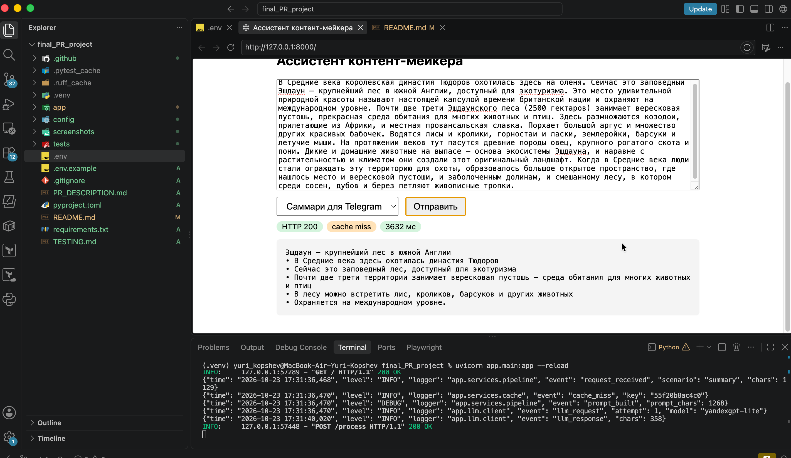
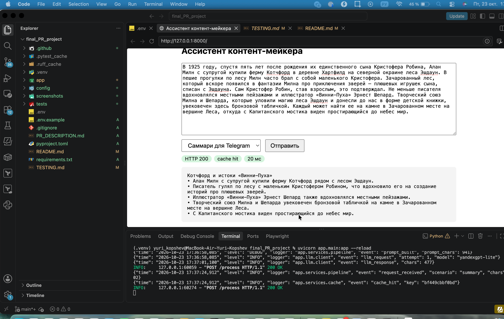
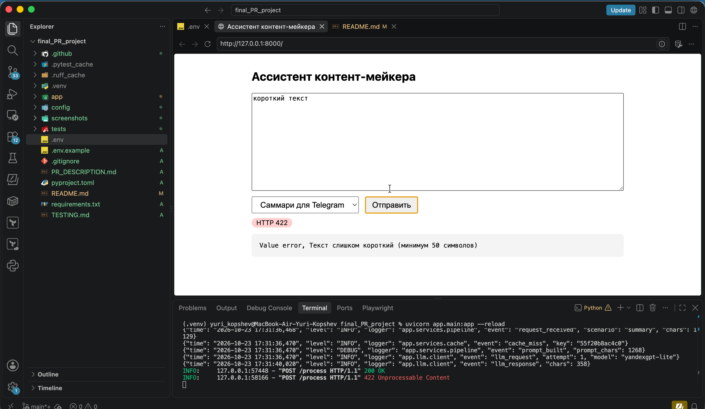
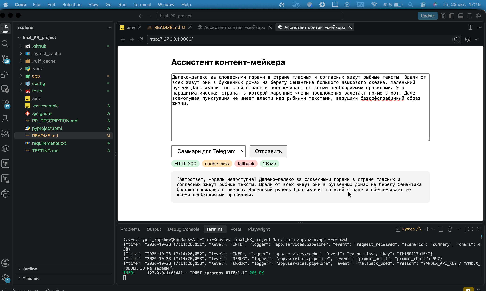

# Тестирование

## Автотесты (`pytest -q`, LLM подменён заглушкой) — 10 passed
| Сценарий | Тест | Результат |
|---|---|---|
| Валидный запрос → успех | `test_success` | 200, `fallback:false` |
| Ошибка ввода | `test_validation_error`, `test_too_long` | 422 / 413 |
| Сбой LLM → fallback | `test_fallback_when_llm_down`, `test_headlines_postprocess_requires_five` | 200, `fallback:true` |
| Кеш | `test_cache_hit_and_not_cached_fallback` | второй запрос `cached:true`, LLM вызван 1 раз |
| TTL | `test_cache_ttl_expires` | после TTL — снова miss |

`ruff check .` — All checks passed.

## Ручная проверка (сервер запущен без ключа)
**Fallback** (нет `YANDEX_API_KEY`):
```
{"scenario":"summary","result":"[Автоответ, модель недоступна] Это достаточно длинный текст ...","cached":false,"fallback":true}
```
Лог: `cache_miss` → `prompt_built` → `fallback_used` (ERROR).

**Валидация** (`text:"коротко"`): HTTP 422, `Текст слишком короткий (минимум 50 символов)`.

## Демонстрация (скриншоты, реальный ключ YandexGPT)

### 1. Успешный запрос: HTTP 200, `cache miss`, ответ модели
Логи: `request_received` → `cache_miss` → `prompt_built` → `llm_request` → `llm_response`.



### 2. Повторный запрос: `cache hit`, ответ за миллисекунды
Тот же текст и сценарий; в логе `cache_hit`, вызова LLM нет.



### 3. Ошибка валидации: HTTP 422
Текст короче 50 символов, запрос не доходит до LLM.



### 4. Сбой внешнего вызова: fallback
Ключ не задан или отключён: HTTP 200, `fallback:true`, автоответ из первых предложений текста. В логе ERROR `fallback_used`.


